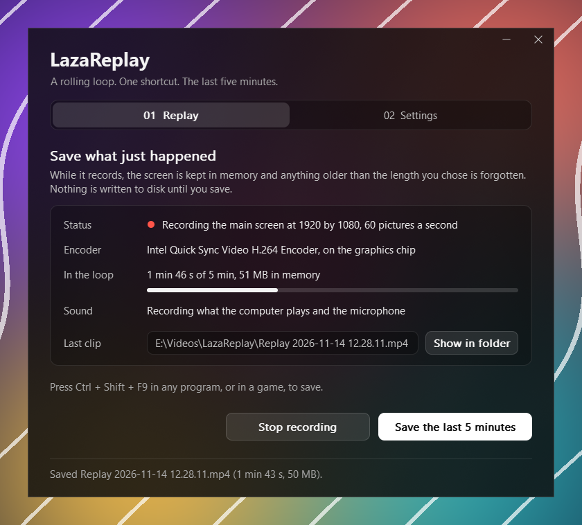
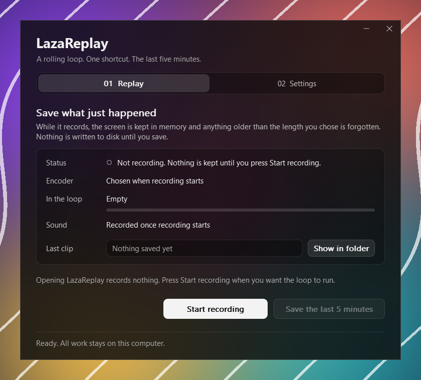
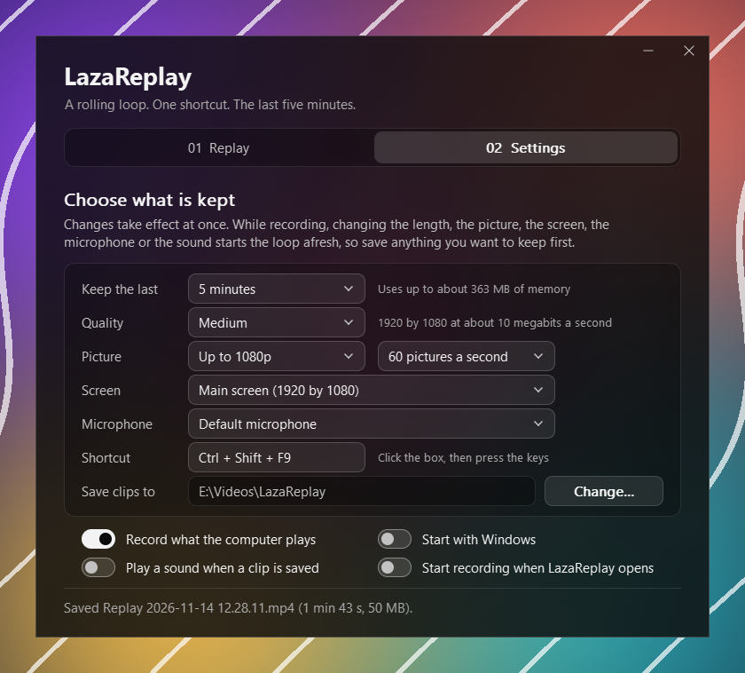

<p align="center"></p>

<h1 align="center">LazaReplay</h1>
<p align="center">A rolling loop. One shortcut. The last five minutes.</p>

<p align="center">
  
  
  <a href="LICENSE"></a>
</p>

**LazaReplay is a portable Windows utility that keeps the last few minutes of your screen in memory and saves them as an MP4 when you press a shortcut.** Once you press Start it records all the time and stores nothing, so when something worth keeping has just happened, in a game or anywhere else, it is already recorded. The video is compressed by the graphics chip, which is why it can run while you play. Opening the program records nothing: recording starts when you start it.

[Download the latest Windows release](https://github.com/kimineechan/LazaReplay/releases/latest) · [Usage guide](docs/USAGE.md) · [How it works](docs/HOW-IT-WORKS.md) · [Report a bug](https://github.com/kimineechan/LazaReplay/issues/new/choose)

<p align="center"></p>

## Features

| Feature | What it does |
| --- | --- |
| Rolling loop | Keeps the last 30 seconds to 10 minutes of the screen. Anything older is forgotten |
| Starts when you say | Opening the program records nothing. Recording starts when you press **Start recording**, in the window or on the menu of the icon by the clock, and stops when you press **Stop recording** |
| Save on demand | A shortcut that works in any program or game, a button, or the icon by the clock writes the loop to an MP4 file |
| Hardware encoding | Uses Intel Quick Sync, NVIDIA NVENC or the AMD encoder, whichever belongs to the chip that drives the screen |
| Sound | Records what the computer plays, kept in step with the picture, and your microphone as well if you choose one |
| Mouse pointer | Drawn into the recording, including the kinds that invert what is under them |
| Memory only | The loop lives in memory. Nothing is written to disk until you save, and it is wiped when you stop or exit |
| Self-check | `lazareplay-check.exe` tests the recorder on your own computer and prints a report |
| Dark, see-through window | Black, with rounded controls and a blurred view of what is behind it. LazaReplay draws it itself, with no web view or interface toolkit, and draws nothing while the window is closed |
| Portable and local | Native Windows interface, no installer, network client, or telemetry |

## What it costs

A replay recorder is only useful if you can leave it running. These figures were measured on the laptop LazaReplay was developed on: an Intel Core 9 270H with Intel graphics driving the screen and a GeForce RTX 5070 beside it. The recording was 1920 by 1080 at 60 pictures a second with sound, of a screen redrawing 144 times a second.

| Resource | Use |
| --- | --- |
| Processor | About 7% of one core, which is 0.35% of that processor |
| Graphics chip that drives the screen | About 4% of its 3D engine and 12% of its video engine |
| The other graphics chip, where games run | None |
| Memory | About 170 MB, plus the loop |
| Loop at medium quality | About 363 MB for five minutes when the picture is busy all the time. A quiet desktop uses far less |
| Disk | Nothing until you save |
| Open but not recording | About 20 MB of memory and no processor time worth measuring |

While the screen is still, one picture a second is recorded and the processor use falls to almost nothing. Saving compresses nothing again, so it is quick: in testing a 15 MB clip was written in 15 milliseconds. The file is written at background priority, so a game loading from the same disk is served first.

Other computers will differ. The figures have not been measured while a game was running. See [VALIDATION.md](VALIDATION.md) for what was tested and where the testing stops.

## Download and run

1. Open [Releases](https://github.com/kimineechan/LazaReplay/releases).
2. Download `LazaReplay-v1.2.0-windows-x64.zip`.
3. Extract the ZIP and open `LazaReplay.exe`.

LazaReplay targets **64-bit Windows 10 and Windows 11**. It needs no Go, Python, Node, or separate application framework.

Release assets include `SHA256SUMS.txt`. Check the ZIP in PowerShell with:

```powershell
Get-FileHash .\LazaReplay-v1.2.0-windows-x64.zip -Algorithm SHA256
```

Compare the result with its entry in `SHA256SUMS.txt`.

## Record and save

<p align="center"></p>

1. Open `LazaReplay.exe`. Nothing is recorded yet. **01 Replay** says so, and the icon by the clock is a plain ring.
2. Press **Start recording**. The light in the window turns red, the icon by the clock gains a red dot, and **01 Replay** shows the screen, the encoder and how full the loop is.
3. Carry on with what you were doing. Closing the window leaves LazaReplay by the clock, still recording.
4. When something has just happened that you want to keep, press **Ctrl + Shift + F9**. The clip is saved to the `LazaReplay` folder in your Videos folder.
5. **Stop recording** stops the recorder and wipes the loop. **Exit**, on the menu of the icon by the clock, closes the program.

<p align="center"></p>

**02 Settings** sets how much is kept, the quality, the picture size and rate, which screen is recorded, which microphone if any, the shortcut, whether what the computer plays is recorded, and where clips go. Each choice shows what it costs in memory. Two switches decide how LazaReplay starts: **Start with Windows** opens it by the clock when you sign in, and **Start recording when LazaReplay opens** makes it record without being asked. Both are off unless you turn them on.

See the [usage guide](docs/USAGE.md) for every setting, the command-line switches and what each status message means.

## Which encoder it uses

LazaReplay picks the encoder that belongs to the graphics chip driving the screen you record, because that chip already holds the picture and nothing has to be copied.

| Chip that drives the screen | Encoder |
| --- | --- |
| Intel | Intel Quick Sync Video, through Windows Media Foundation |
| NVIDIA | NVENC, driven directly through the library every NVIDIA driver installs |
| AMD | The AMD encoder, through Windows Media Foundation |
| None of these works | The software encoder built into Windows, kept light at 1280 by 720 and 30 pictures a second |

On a laptop with two graphics chips the built-in screen is usually driven by the processor's own chip while games run on the other. LazaReplay then records and encodes on the first and leaves the second alone.

If an encoder fails soon after starting, twice, LazaReplay passes it over and uses the next. `lazareplay-check.exe` shows which encoders your computer has and tests the one that would be used.

## Compatibility and limits

- Recording stops showing new pictures while Windows shows the lock screen or an administrator prompt. LazaReplay waits and resumes by itself.
- Films and series that a browser or app marks as protected are recorded as a black rectangle. Windows withholds them from every recorder.
- A screen that is turned on its side is recorded as the panel sees it, sideways, and without the mouse pointer.
- A screen in HDR mode is recorded in standard range, and may look washed out.
- A screen larger than 4096 by 2160 is scaled down to fit. Picture sizes above 1080p are a setting; 1080p is the default.
- Sound is whatever plays on the default playback device. A microphone is recorded only if you choose one in Settings. It is mixed into the same sound track as the rest, so its loudness cannot be changed in the clip afterwards.
- One screen is recorded at a time.
- AMD graphics chips, NVIDIA desktop cards and Windows 11 have not been tested by the author. The self-check will tell you how LazaReplay fares on yours.
- The window is drawn by LazaReplay itself, so a screen reader cannot read its controls. The menu of the icon by the clock is a standard Windows menu that a screen reader can read, and the command-line switches start, stop, save and exit.
- On Windows 10 the window has square corners, as every window there does. Windows 11 rounds them.
- Remote Desktop sessions cannot be recorded. Windows does not offer the screen there.
- The executables are unsigned, so Windows SmartScreen may ask for confirmation the first time.

## What it does and does not do with your screen

LazaReplay records your screen for as long as recording is switched on, so it is worth being exact.

- Nothing is recorded until you press **Start recording**. Opening the program records nothing, and neither does having it start with Windows, unless you have turned on **Start recording when LazaReplay opens**, which is off to begin with.
- No microphone is recorded unless you choose one under **02 Settings**. The list starts at **Off**.
- The recording is held in memory, compressed. It is not written to disk, in any form, until you save a clip.
- Stopping or exiting wipes it.
- The icon by the clock is there whenever LazaReplay is running: a ring with a red dot while it records, the ring alone while it does not. There is no way to run it without that icon.
- The program has no network code. Nothing is uploaded, checked for or reported.
- A saved clip carries no metadata beyond the time it was created.
- Settings are one small JSON file in your own application data folder.

## Build from source

Install [Go](https://go.dev/dl/) 1.25 or newer, clone the repository, and open a terminal in its root:

```powershell
git clone https://github.com/kimineechan/LazaReplay.git
cd LazaReplay
.\build.cmd
```

The results are `dist\LazaReplay.exe` and `dist\lazareplay-check.exe`. The build script runs `go vet` and the tests, then builds both programs. Run `dist\lazareplay-check.exe` afterwards to test the recorder against your own graphics chip.

The project uses the Go standard library and native Windows APIs. No third-party Go modules are required and CGO is off. The icon and the Windows resources are generated by `tools/mkres`, which is also plain Go.

Create the release ZIP after building:

```powershell
.\scripts\package.ps1
```

See [CONTRIBUTING.md](CONTRIBUTING.md) for development checks and [docs/GITHUB.md](docs/GITHUB.md) for release publishing.

## How it works

Windows hands LazaReplay the picture of the screen as a texture on the graphics chip. A small program run by the chip converts it to the format video encoders take, the chip's encoder compresses it, and only the compressed result, a few kilobytes a picture, is copied into main memory. The uncompressed picture never leaves the chip.

The compressed video is kept as a list of short groups, each starting with a keyframe, which is a picture that can be decoded on its own. Old groups are dropped whole. Saving copies the list, not the footage, and writes an MP4 with its index at the front so players can start and seek at once. The MP4 writer, the H.264 stream reader and the loop are written for this project.

The capture loop wakes 60 times a second, but asks Windows for a picture in a way that makes Windows copy the desktop once per wake, not once per redraw of a 144 Hz screen, and it sleeps inside that request when nothing changes.

The window is one picture. LazaReplay draws it with its own small drawing code, gives every pixel its own opacity and hands it to Windows, which blurs what is behind it. Only the part that changed is redrawn, and nothing is drawn while the window is hidden or minimised.

The full description is in [How LazaReplay works](docs/HOW-IT-WORKS.md), and the checks behind these claims are in [VALIDATION.md](VALIDATION.md).

## Contributing and licence

Bug reports with a self-check report, results from hardware the author does not have, and focused pull requests are welcome. Please read [CONTRIBUTING.md](CONTRIBUTING.md).

MIT licence. See [LICENSE](LICENSE). The notices for the Go runtime and for NVIDIA's interface definition are in [THIRD-PARTY-NOTICES.txt](THIRD-PARTY-NOTICES.txt).
