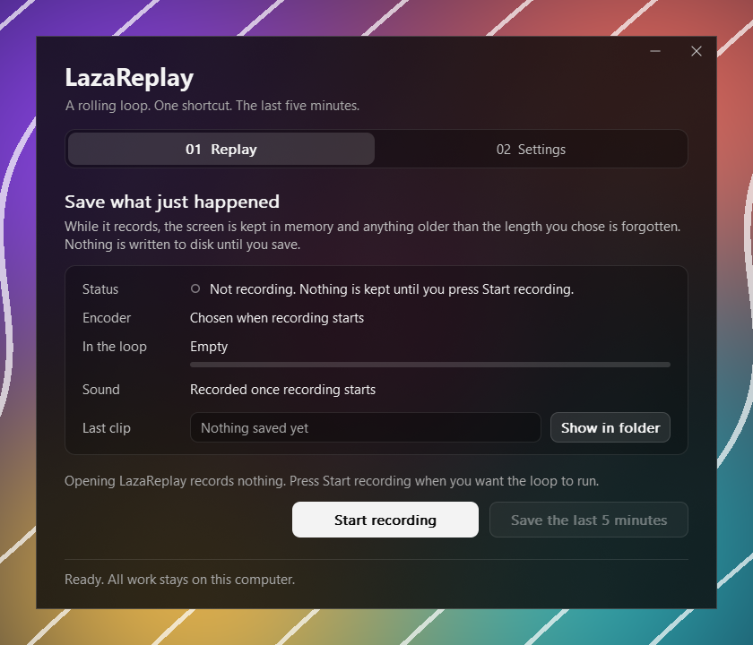
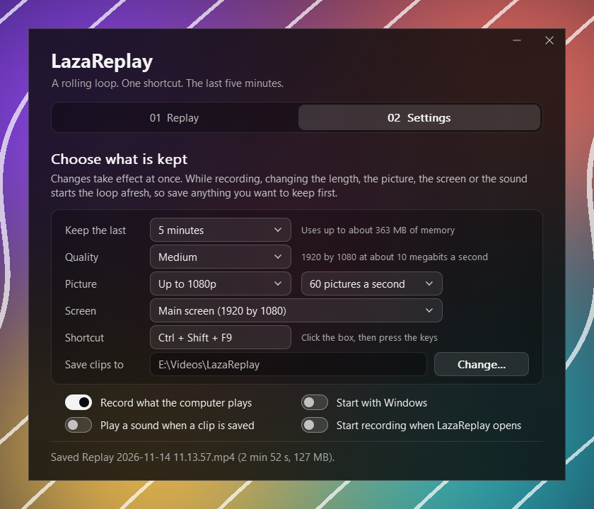

# Using LazaReplay

## Start

Extract the ZIP anywhere and open `LazaReplay.exe`. There is nothing to install.

Opening the program records nothing. The window opens on **01 Replay**, which says **Not recording**, and the icon by the clock is a plain ring. Press **Start recording** when you want the loop to run.

Windows may show a SmartScreen warning the first time, because the program is not signed. Choose **More info**, then **Run anyway**.

## The window

The window is black and see-through: what is behind it shows through, blurred, so it gives colour and no detail. It has no title bar from Windows. Drag it by its top part, around the name, and use the two buttons at its top right corner to minimise it or to close it.

With the keyboard, **Tab** and **Shift + Tab** move from control to control and a white ring shows where you are. **Enter** or **Space** presses a button or flips a switch. On a list, **Enter**, **Space** or an arrow key opens it, the arrow keys move through it, **Enter** chooses and **Esc** leaves it as it was. **Ctrl + Tab** changes section.

The see-through effect does not depend on the **Transparency effects** setting of Windows. With high contrast turned on in Windows the window is solid black.

## 01 Replay

| Line | Meaning |
| --- | --- |
| Status | A light and a sentence. A grey ring: not recording. Red: recording, with the screen, the picture size and how many pictures a second. Amber: starting, or held up, and the sentence says by what |
| Encoder | The video encoder in use, and whether it runs on the graphics chip or on the processor. It is chosen when recording starts |
| In the loop | How much footage is held, out of the length you chose, and the memory it takes |
| Sound | Whether what the computer plays is being recorded, or why not |
| Last clip | The file saved most recently. **Show in folder** opens its folder with the file selected |

**Start recording** begins recording into an empty loop. While LazaReplay records, the same button reads **Stop recording**: it stops the recorder and wipes the loop from memory. Use it before doing anything you would not want in a clip.

**Save the last 5 minutes** writes the loop to a new MP4 file. The loop is not emptied, so you can save again later and the clips will overlap. The button cannot be pressed while nothing is being recorded.

The lighter of the two buttons is the one for the thing to do next: Start while nothing is recorded, Save once something is.

A clip can be a little longer than the length you chose, by up to two seconds. Video can only start from a keyframe, a picture that does not depend on earlier ones, and LazaReplay makes one every two seconds.

## Saving from anywhere

The shortcut, **Ctrl + Shift + F9** unless you change it, saves a clip whichever program is in front, including a game running full screen. If **Play a sound when a clip is saved** is switched on you hear the Windows notification sound when the file is written, which is the confirmation when the window is not on show.

If you press the shortcut while LazaReplay is not recording, nothing is saved. The line at the foot of the window says so, a message appears by the clock if the window is closed, and with the sound switched on you hear a different sound, the one Windows uses for a warning.

Clips are named after the moment they were saved, such as `Replay 2026-11-14 14.03.22.mp4`.

## The icon by the clock

Closing the window does not close LazaReplay. It stays by the clock, in the notification area, recording if it was recording. Windows may tuck the icon into the overflow list, the small arrow next to the clock; drag it out to keep it in view.

| Icon | Meaning |
| --- | --- |
| A ring | LazaReplay is open and not recording |
| A ring with a red dot | LazaReplay is recording |

- **Click** the icon to open the window.
- **Right-click** it for the menu: **Start recording** or **Stop recording**, save a clip, open the window, open the clips folder, and **Exit**. Saving is greyed while nothing is being recorded.

Resting the pointer on the icon says the same in words.

## 02 Settings

Changes take effect at once and are remembered. While LazaReplay is recording, changing the length, the quality, the picture, the screen or the sound starts the loop afresh, so save first if there is something in it you want. While it is not recording, changes only set what the next recording will use.

| Setting | What it does |
| --- | --- |
| Keep the last | The length of the loop: 30 seconds, 1, 2, 5 or 10 minutes. The line beside it shows the most memory the loop will take |
| Quality | Low, Medium or High. Higher quality is a higher bitrate, which is more memory and larger files. The line beside it shows the picture size and bitrate that result |
| Picture | The tallest picture to record. A larger screen is scaled down to it; a smaller one is never scaled up. Then the rate: 30 or 60 pictures a second |
| Screen | Which screen to record, when there is more than one |
| Shortcut | Click the box and press the keys you want. A key on its own, or with Shift alone, has Ctrl and Alt added to it, because otherwise it would be taken away from every other program. **Backspace** or **Delete** in the box removes the shortcut |
| Save clips to | The folder for clips. **Change** picks another |
| Record what the computer plays | Sound from the default playback device. Switch off for silent clips |
| Play a sound when a clip is saved | The confirmation described above |
| Start with Windows | Opens LazaReplay when you sign in, with no window, by the clock. It does not record until you start it there, unless the next switch is on |
| Start recording when LazaReplay opens | Makes LazaReplay record as soon as it opens, however it was opened, without waiting for **Start recording**. Off unless you switch it on |

With both of the last two switched on, LazaReplay records from the moment you sign in, as version 1.0.0 did.

### How much memory

The loop holds compressed video, so its size is the bitrate multiplied by the length. These are the largest sizes for a 1920 by 1080 picture at 60 a second with sound, reached only when the picture is busy all the time. A quiet desktop uses a small fraction.

| Length | Low | Medium | High |
| --- | --- | --- | --- |
| 30 seconds | 18 MB | 36 MB | 65 MB |
| 1 minute | 37 MB | 73 MB | 130 MB |
| 2 minutes | 74 MB | 145 MB | 260 MB |
| 5 minutes | 185 MB | 363 MB | 649 MB |
| 10 minutes | 369 MB | 727 MB | 1.3 GB |

At 30 pictures a second the sizes are about six tenths of these.

While it is not recording LazaReplay holds no loop at all and uses about 20 MB.

## Starting and stopping from a script

LazaReplay runs one copy at a time. Starting it again talks to the copy that is running.

| Command | Effect |
| --- | --- |
| `LazaReplay.exe` | Opens it, not recording, or brings the running copy's window to the front |
| `LazaReplay.exe --tray` | Opens it with no window, not recording |
| `LazaReplay.exe --start` | Tells the running copy to start recording. If none is running, opens LazaReplay and starts recording at once |
| `LazaReplay.exe --tray --start` | Opens it with no window and recording |
| `LazaReplay.exe --stop` | Tells the running copy to stop recording and wipe the loop |
| `LazaReplay.exe --save` | Tells the running copy to save a clip. If it is not recording, nothing is saved |
| `LazaReplay.exe --exit` | Tells the running copy to close. A clip that is being written is finished first |

`--stop`, `--save` and `--exit` do nothing when no copy is running. `--start`, `--stop` and `--save` let a macro key, a stream deck or a second shortcut tool work the recorder.

## The self-check

`lazareplay-check.exe` tests the recorder on your computer. Double-click it, or run it in a terminal. It takes under a minute and prints a report:

1. The graphics chips, the screens on each, and the video encoders each offers.
2. For every screen, a recording of a generated test picture made through that screen's chip. The saved clip is played back with the decoders built into Windows and compared with the picture by numbers: every frame present and in order, the colours, the mouse pointer, the time between pictures, and sound in step with the picture.
3. For every screen, three seconds of the real screen and sound, to see that capture works. Nothing on the screen is examined, and the clip is deleted.
4. The software encoder, which is the fallback when no hardware encoder works.

Each check ends in `ok` or `FAILED`. Paste the whole report into a bug report: it says exactly which encoder was used and what went wrong.

The self-check does not need LazaReplay to be recording, and does not start it.

## Status messages

| Message | What it means |
| --- | --- |
| Not recording. Nothing is kept until you press Start recording. | LazaReplay is open and idle. The loop is empty |
| Starting... | The recorder is being set up. This takes under a second |
| LazaReplay is not recording, so there is nothing to save. | The shortcut, the menu or `--save` asked for a clip while nothing was being recorded |
| Stopped. The loop was wiped from memory. | **Stop recording** was pressed. What had been recorded is gone |
| Windows is showing a protected screen. Recording will resume by itself. | The lock screen or an administrator prompt is up. Windows does not let programs see those |
| The graphics driver restarted. Recording will resume by itself. | A driver update or reset. The loop carries on from where capture resumes |
| This screen cannot be captured, for example over Remote Desktop. | Windows does not offer this screen for duplication |
| Too many programs are capturing the screen at once. | Windows limits how many programs can duplicate one screen. Close another recorder |
| No video encoder could be started | Neither a hardware encoder nor the Windows software encoder would start. The message lists why. Run the self-check |
| No playback device was found, so clips will be silent. | There is nothing to record sound from |
| The media features of Windows are missing. | An N or KN edition of Windows without the Media Feature Pack. Add it under Settings, Apps, Optional features |
| *Shortcut* is taken by another program. | Another program registered the same keys first. Choose a different shortcut in Settings |
| There is not enough room on that disk | The clip was not saved. Free some space or change the folder, then save again; the loop is still in memory |

## Where things are kept

| What | Where |
| --- | --- |
| Clips | The `LazaReplay` folder in your Videos folder, unless you chose another |
| Settings | `%APPDATA%\LazaReplay\settings.json` |
| Start with Windows | An entry named LazaReplay in the per-user start-up list, which Task Manager shows under Start-up apps |

To remove LazaReplay, switch off **Start with Windows**, exit it, and delete the program and the settings folder.

## Games

LazaReplay records the screen the way Windows composes it, and does not attach itself to the game, so it works with games that do not allow overlays. Three things are worth knowing.

- Start recording before you start playing, from the window or from the icon by the clock, then close the window. Closed, the window costs nothing: it is not drawn at all.
- Record the screen the game is on. On a laptop, the built-in screen is usually driven by the processor's graphics chip even when the game runs on the other one; that is the best case, because recording then uses a chip the game is not using.
- If the picture size is above 1080p, 1080p at 60 a second is the setting that costs least for a result that still looks sharp.
